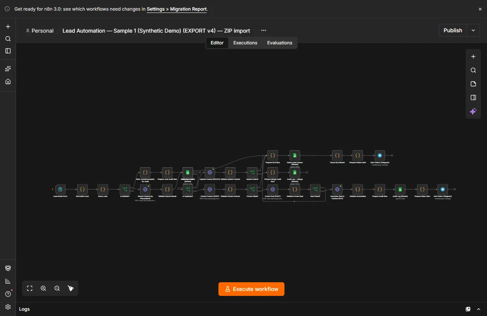
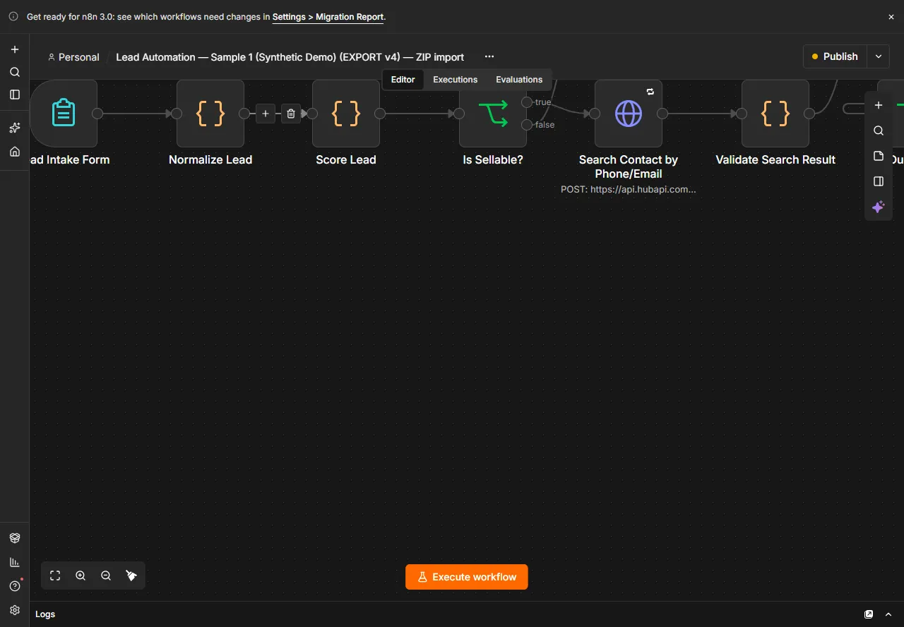
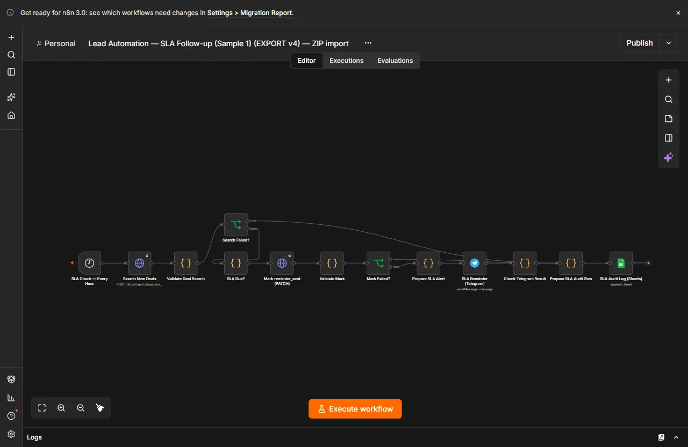
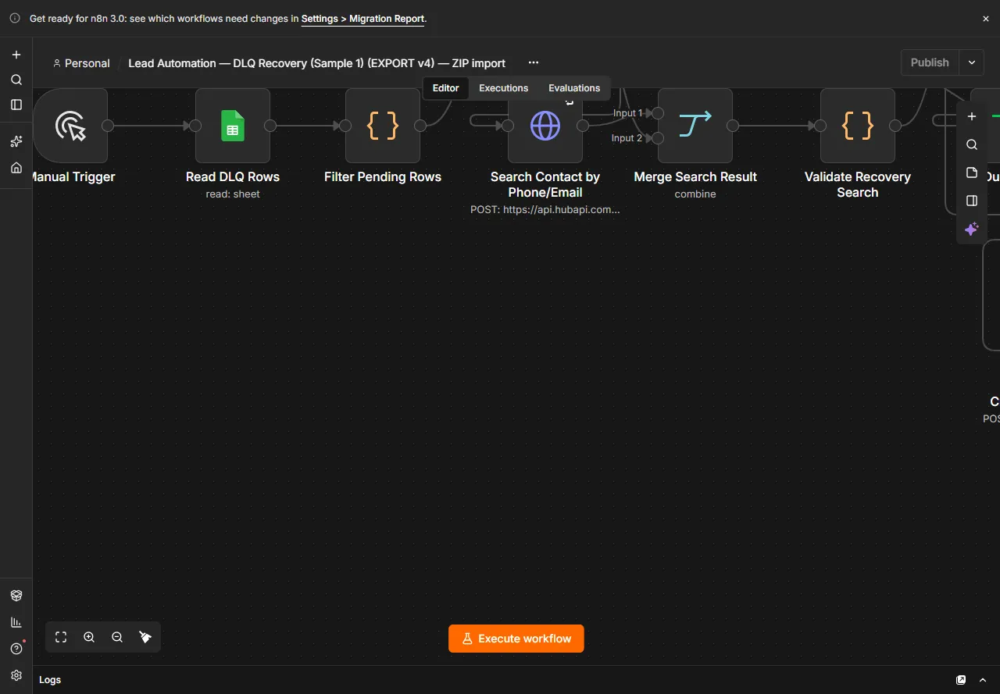
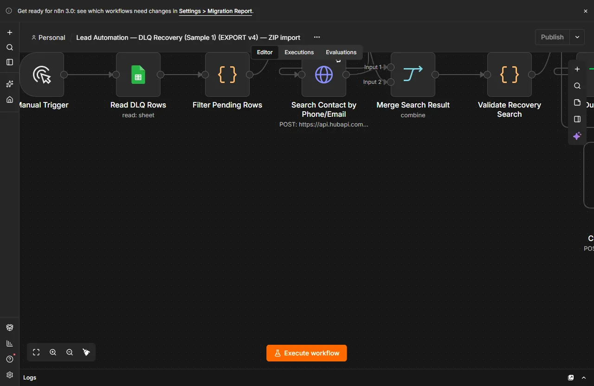

# Lead Automation — Sample 1

**Synthetic data only. No real commercial results are claimed.**
All names, phones, emails and budgets in `eval-set.csv` are invented for testing.

## What it does

A lead arrives from a form (WhatsApp / email in the full design), is cleaned and scored, checked for duplicates, and recorded in a real CRM — HubSpot Free. Good leads reach sales immediately on Telegram. Junk is logged, not sold to. Incomplete leads go to a manual review queue. If HubSpot fails, the lead is saved in a Google Sheets dead-letter queue and retried. In the local logic test no lead was dropped; this is not a live guarantee — Telegram is a notification, not durable storage.

This is not a lead-scoring template. The difference is the full journey: capture → clean → dedup → score → CRM → alert → SLA follow-up → failure handling → audit log.

## 90-second demo

See `demo-script.md` for the exact script. In short:
1. **0–25s:** L01 (Hot, new) arrives → appears in HubSpot in seconds → Telegram alert to sales.
2. **25–55s:** L07 (same phone as L01) arrives → merged into the original contact, no second deal.
3. **55–90s:** L16 with simulated HubSpot failure → saved to the dead-letter queue, retry scheduled, Telegram failure alert. No lead was dropped by the logic in the local test. This is not a live guarantee.

## Files

| File | What it is |
|---|---|
| `scope.md` | Fixed scope, scoring rules, dedup rules, SLA, failure handling |
| `eval-set.csv` | 20 synthetic leads + expected outcome for each |
| `test-logic.py` | The scoring/dedup logic, runnable offline |
| `test-results.txt` / `test-results.json` | Test run: **20/20 passed, 0 leads dropped by the logic in the local test** |
| `workflow-spec.md` | Node-by-node n8n design (v3 — tested in real n8n 2.48.7) |
| `lead-automation-workflow.json` | Main n8n workflow, importable, credentials empty — target n8n 2.48.7 (33 nodes) |
| `sla-workflow.json` | SLA follow-up workflow (mark reminder_sent first, then alert) (13 nodes) |
| `error-workflow.json` | Error Trigger workflow for failures before a lead is recorded (5 nodes) |
| `dlq-recovery-workflow.json` | Dead-letter queue recovery workflow (25 nodes) |
| `build_workflows_v3.py` + `builders_v3_extra.py` | The builder that generates all workflow JSONs (single source; never hand-edit JSON) |
| `exported-from-n8n/` | The 4 real workflows as exported by n8n 2.48.7 itself (identical to the builder output; included in the ZIP) |
| `mock-server.js` + `run_n8n_tests.py` | Mock HubSpot/Sheets/Telegram server + the 58-check test runner (T0–T13) |
| `n8n-test-results.json` | Full mock test run: **58/58 passed in real n8n 2.48.7** |
| `failure-matrix-test.py` / `failure-matrix-results.txt` | Failure matrix (logic only): **9/9 passed** |
| `sla-test.py` / `sla-test-results.txt` | SLA time simulation (logic only): **4/4 passed** |
| `review-report.md` | Review report: Verified / Needs Fix / Blocked / Not Tested (v3 evidence) |
| `setup-instructions.md` | Manual setup steps, including HubSpot custom properties, placeholders, and post-import steps |
| `case-study.md` | Short case study (synthetic) |
| `demo-script.md` | 90-second demo script |

## Test evidence (real n8n 2.48.7 + mock services, not a live run yet)

```
python3 run_n8n_tests.py
== 58 passed, 0 failed ==
```

- T0: static uniformity checks (stage/pipeline defined once, one value in all JSONs, SLA Due? has no stage re-check, DLQ columns in setup match the builder).
- T1–T7: main workflow end-to-end (Hot lead, duplicate merge, Junk/Incomplete gating, contact failure → DLQ, partial deal failure, search failure).
- T8–T10, T8b, T9b, T13: DLQ recovery (deal-only recovery, fresh row, failing row retry_count +1, no duplicate contacts; recovered deals are associated to their contact whether it existed or was created during recovery; an association failure still recovers the row with the failure noted).
- T11–T12: SLA (only due deals reminded, no duplicates on re-run, Telegram failure after mark is safe).
- Duplicates caught: L07 → L01, L08 → L02, L09 → L03.
- False-positive check passed: L20 (similar name, different phone) was **not** treated as a duplicate.
- **Status: tested in real n8n against mock services. Live HubSpot/Sheets/Telegram run is still pending** — it needs the user's n8n instance, a HubSpot Free account, and a Telegram bot.

## Setup (to run it live)

1. Create a HubSpot Free account, one pipeline: New → Qualified → Contacted → Won/Lost.
2. Create a Telegram bot and note its chat ID for sales alerts.
3. In n8n, import `lead-automation-workflow.json`, fill in the HubSpot, Google Sheets and Telegram credentials (none are in this repo).
4. Create a Google Sheet with tabs `Dead_Letter_Queue` and `Audit_Log`.
5. Run the 20 leads in `eval-set.csv` and compare with `test-results.txt`.

## What it does NOT do

- No automatic pricing, no quotes, no voice calls, no ad integrations, no WhatsApp marketing messages.
- No claim that these 20 synthetic leads produced real sales or revenue.

## Screenshots







## Demo Video

- [Demo Video (MP4)](demo/lead-automation-final-77s.mp4)
- [90-second Demo Script](demo/demo-script.md)
